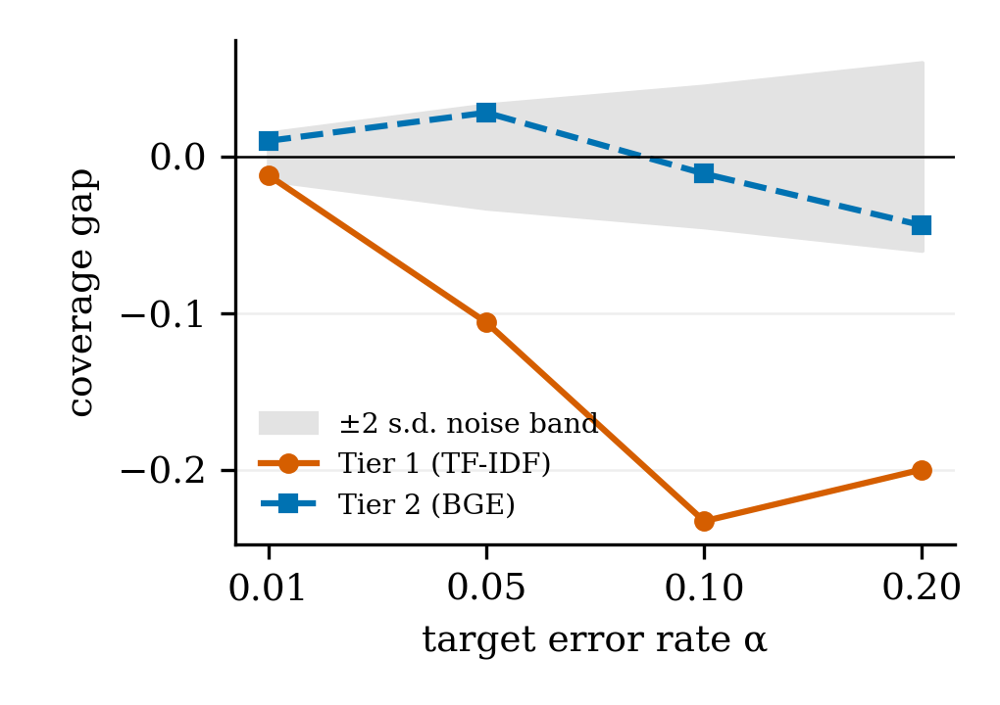
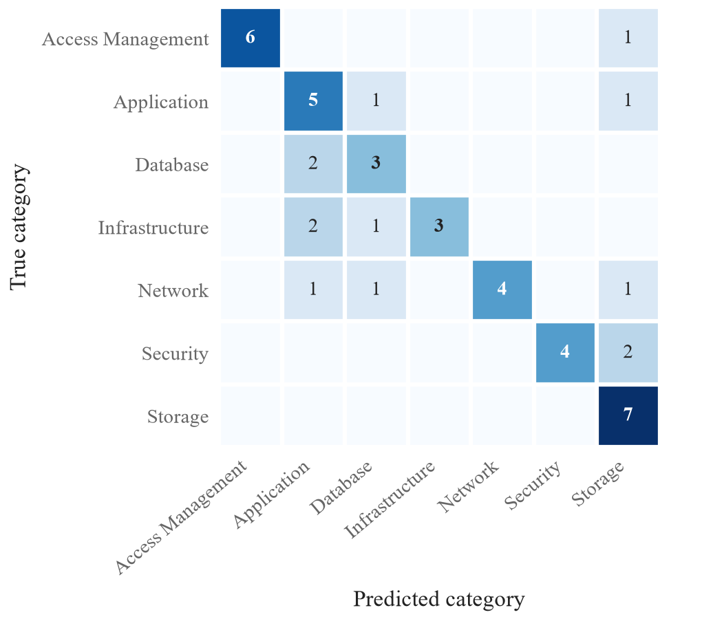

# Calibrated Escalation for IT Ticket Triage: What the Calibration Distribution Decides

## Online Supplement

Online supplement to the paper above, submitted to IConAECC 2026. It holds the appendices of the full version (v4), moved here unchanged to meet the six-page limit, and two figures removed from the paper. Every number is regenerated from the committed result files in the repository, https://github.com/aryanwaingankar4/ticket-routing-resolution-agent.

## S-A. Prompts

**Drafting prompt.** The ‘Past ticket #k’ block is repeated for each of the top-5 retrieved tickets, k = 1…5.

```text
You are an IT-support assistant that drafts suggested resolutions for new support tickets.

IMPORTANT INSTRUCTIONS:
- Base your suggestion ONLY on the RETRIEVED PAST TICKETS below. These are real past fixes from our ticket history.
- Do NOT invent a generic answer from outside knowledge. Ground every step in what the retrieved resolutions actually did.
- If the retrieved examples do not fully match the new ticket, say so explicitly and recommend that a human agent double-check.
- Keep the suggestion concise: a few sentences of clear, actionable steps.

================ NEW TICKET (needs a resolution) ================
Title:       <NEW TICKET TITLE>
Description: <NEW TICKET DESCRIPTION>

================ RETRIEVED PAST TICKETS ================

--- Past ticket #1 (similarity <SIMILARITY, 3 d.p.>, category: <PAST CATEGORY>) ---
Title:       <PAST TITLE>
Description: <PAST DESCRIPTION>
Resolution:  <PAST RESOLUTION>

================ YOUR TASK ================
Write a concise SUGGESTED RESOLUTION for the NEW TICKET, grounded in the retrieved past resolutions above. End with a one-line note stating whether the retrieved examples closely match or whether a human should verify.
```

**Zero-shot classification prompt.** 

```text
Classify this IT support ticket into exactly one category.

TICKET:
<TICKET TEXT>

CATEGORIES:
  - Infrastructure
  - Application
  - Security
  - Database
  - Storage
  - Network
  - Access Management

Answer with STRICT JSON, exactly:
{"category": "<one of the categories above, copied exactly>"}
```

## S-B. Reproduction Steps

1. Environment: python -m venv venv; .\venv\Scripts\Activate.ps1; pip install -r requirements.txt (Python 3.14.3); for the revision analyses also pip install -r requirements-revision.txt. GEMINI_API_KEY in .env is needed only for steps that call Gemini.

2. Data, models and index: python data/generate_dataset.py; python src/classification/train_tier1.py; python src/classification/train_embeddings.py; python src/rag/build_vector_index.py.

3. Threshold calibration: python src/classification/train_cascade.py; python -m src.experiments.calibrate_rag_similarity_threshold; python -m src.experiments.calibrate_conformal.

4. Evaluation: python src/experiments/test_adversarial_escalation.py; python src/experiments/run_ablation_study.py --mode {baseline, tier2-only, no-cascade, no-rag}; python src/experiments/compare_cascade_vs_tier2.py; python src/experiments/measure_inference_latency.py; python src/experiments/run_zeroshot_baselines.py and compare_zeroshot_vs_tier2.py; python src/experiments/score_groundedness_set.py; python src/experiments/score_sufficiency_gate.py.

5. Revision analyses and figures: python scripts/reproduce_cascade_calibration_curve.py; python scripts/reproduce_ood_similarities.py; python scripts/error_analysis_benchmark45.py; python scripts/export_prompts.py; python scripts/make_revision_figures.py; python scripts/make_paper_figures.py.

6. Extended evaluation: python scripts/fetch_zenodo_tickets.py; python scripts/prepare_zenodo_tickets.py; python scripts/run_realworld_routing.py; python scripts/score_realworld.py (and --variant fileservice_storage); python scripts/draft_realworld.py (calls Gemini); python scripts/eval_independent.py.

7. Tables, numbers and checks: python src/experiments/build_paper_artifacts.py --force; pytest.

## S-C. Sensitivity of the Real-World Result to the Category Mapping

Table S-I repeats the real-world evaluation of Section VI-E of the paper with the Fileservice category mapped to Storage instead of Access Management; everything else is unchanged. Sources: realworld_summary.csv and realworld_summary_sens_fileservice_storage.csv in data/external_zenodo_7648117/.

**TABLE S-I. Real-world results under the primary mapping (file-share access requests → Access Management) and the sensitivity mapping (→ Storage). Distinct texts, n = 583. 95% Wilson intervals in brackets**

| Quantity | Primary | Sensitivity |
|---|---|---|
| Cascade correct | 115/583 (19.7%) [16.7, 23.1] | 294/583 (50.4%) [46.4, 54.5] |
| Tier 2 alone correct | 114/583 | 292/583 |
| Exact McNemar, cascade vs Tier 2 | p = 1.0 | p = 0.79 |
| Recall, Access Management | 86/319 | 62/82 |
| Recall, Application | 29/264 | 29/264 |
| Recall, Storage | – | 203/237 |
| Tier-1 answers correct | 39/238 | 199/238 |
| Drafted and correctly routed | 83/454 | 262/454 |
| Escalated at 0.67 | 129/583 (22.1%) | 129/583 (22.1%) |

## S-D. Model Configurations and Hyperparameters

**TABLE S-II. Model configurations and hyperparameters**

| Component | Configuration |
|---|---|
| Tier 1 | TF-IDF, committed vocabulary of 5,000 features, unigrams and bigrams, English stop words removed; logistic regression, max_iter = 1000; otherwise scikit-learn defaults (L2, C = 1.0, lbfgs) |
| Tier 2 | bge-base-en-v1.5 (768-d, frozen) + logistic regression, max_iter = 1000, scikit-learn defaults, fitted on the 3,200-row split |
| Cascade gate | Accept Tier-1 label if top-class probability ≥ 0.50 |
| Retrieval | FAISS inner-product index over normalised BGE embeddings; top-5 neighbours |
| Retrieval gate | Draft only if top-1 cosine similarity ≥ 0.67 |
| Drafting LLM | gemini-flash-lite, API defaults (no generation config set); zero-shot runs at temperature 0.0 |
| Zero-shot baselines | gemini-flash-lite and Qwen2.5-3B (local CPU) with byte-identical prompts |
| Other encoders | MiniLM and E5 with the same logistic head; DistilBERT fine-tuned, 4 epochs, learning rate 2 × 10⁻⁵, batch size 16, maximum length 128, weight decay 0.01 |
| Clustering | Resolution embeddings, similarity threshold 0.80, union-find grouping |
| Conformal | α ∈ {0.01, 0.05, 0.10, 0.20}; noise band = ±2 s.d. of a binomial coverage estimate, n = 175 |
| Seeds, hardware | seed 42 throughout (stratified 80/20 split); latency on an Intel Core i5-1334U (12 logical CPUs), Windows 11, Python 3.14.3, median of 200 runs after 20 warm-up runs |

## S-E. Verification Checks

**TABLE S-III. Checks that run before a result is accepted. A count is given only where a committed file records it**

| Check | What it guards | Count |
|---|---|---|
| Golden parity | Category, tier, escalation and neighbour count equal the recorded decisions exactly | 54 tickets |
| Adversarial gate | Each adversarial ticket escalates or proceeds as expected | 9/9 |
| Gate headroom | No golden similarity lies within its tolerance of the gate; closest, as a multiple of the tolerance | 3.18× |
| Artifact guards | Index and metadata aligned; encoder, index and configured dimension agree; Tier 1 matches its dataset and vocabulary | – |
| Paper parity | Every quoted number is regenerated from a committed result file, and none is typed by hand | – |

## S-F. Methodological Lessons

**Methodological lessons.** An area-under-the-risk–coverage metric showed effects that the pre-registered comparison at the live operating coverage could not resolve, so an averaged metric alone is not a reason to adopt a deferral rule. A pre-registered degeneracy rule blocked our paraphrase-shift experiment, and we kept the rule after seeing the results even though a critique of it was reasonable. On nine occasions a value or artifact was wrong for its context yet internally consistent and silently produced a wrong result; each case is documented in the repository.

## S-G. Additional Figures



*Fig. S1. Coverage gap on the out-of-template benchmark by representation and α, against the two-standard-deviation noise band. The same values are in Table IV of the paper.*



*Fig. S2. Confusion matrix of the production cascade on the 45-ticket benchmark.*

**Examples of misrouted tickets.** For example, N31 (Security: ransomware pop-ups demanding payment) was routed to Storage, N39 (Network: the VPN connection to the company portal fails) to Database, and N13 (Infrastructure: company websites down for the whole office) to Database.
